# ĐỀ XUẤT LỘ TRÌNH PHÁT TRIỂN & TƯ DUY AI-NATIVE
## (Engineering Roadmap & AI-Native Mindset for Enterprise HIS Assistant)

---

### 1. NỀN TẢNG HIỆN TẠI (CURRENT BASELINE) & ĐỊNH HƯỚNG MỞ RỘNG

Hệ thống `his-ai-assistant` trong bài nộp hiện tại được thiết kế theo tôn chỉ **Safety-First (An toàn & Tất định)**:
- **State Machine 7 bước tất định**: Đảm bảo luồng xử lý không bao giờ bị trật ray, có thể kiểm toán (Audit Trail) đầy đủ theo từng vai trò (BA, QC, Dev).
- **Phân quyền Role cứng (RBAC)**: Bảo vệ dữ liệu y tế và quy trình phê duyệt nghiêm ngặt (BA và QC chỉ tiếp cận tài liệu và Code Map; tuyệt đối không để lộ mã nguồn lõi).
- **Git Branch Guard & Human Gate**: Tuyệt đối cấm AI tự merge vào nhánh chính; con người luôn là chốt chặn phê duyệt cuối cùng trước khi thay đổi được ghi nhận.

Đây là **nền tảng an toàn bắt buộc (Rock-Solid Baseline)** đối với một hệ sinh thái đặc thù như Y tế (HIS). Khi hệ thống đi vào vận hành thực tế ở quy mô lớn với hàng trăm kỹ sư, tôi đề xuất **Lộ trình nâng cấp 4 khối kỹ thuật** và **Khung chuyển đổi tổ chức AI-Native** để tối ưu hóa hiệu năng, tiết kiệm chi phí token và từng bước nâng cao mức độ tự chủ.

---

### 2. BỐN CẢI TIẾN KỸ THUẬT TRỌNG TÂM (TECHNICAL IMPROVEMENTS)

#### Cải tiến 1: Phân tầng Ủy quyền & Cấp độ Tự chủ (Graduated Autonomy L0–L5)
*   **Vấn đề thực tế**: Nếu mọi tác vụ dù lớn hay nhỏ đều bắt con người bấm duyệt thủ công (Human-in-the-loop 100%), kỹ sư sẽ rơi vào hội chứng "mệt mỏi phê duyệt" (Approval Fatigue), lâu dần sẽ dẫn đến thói quen bấm duyệt mà không kiểm tra kỹ.
*   **Giải pháp đề xuất**:
    *   Áp dụng mô hình ủy quyền theo rủi ro phân vùng (**Risk-Tiered Autonomy**):
        *   **L1/L2 (Khóa cứng phê duyệt thủ công)**: Các module tài chính, thanh toán viện phí BHYT, trừ kho dược, cấu hình bảo mật. Mọi đề xuất của AI bắt buộc phải có chữ ký số hoặc phê duyệt của kỹ sư phụ trách.
        *   **L3/L4 (Ủy quyền tự động có điều kiện)**: Các tác vụ rủi ro thấp như cập nhật tài liệu kỹ thuật, sinh unit test bổ sung, sửa nhãn giao diện tĩnh. Nếu vượt qua 100% test case trong Sandbox và linter tự động, hệ thống tự động advance bước mà không cần chờ thủ công.
    *   **Nguyên tắc bất biến**: AI không bao giờ được tự thăng cấp; việc mở L3/L4 phải dựa trên Telemetry đo đạc định lượng thực tế (Human Edit Distance < 5%, 50 PR liên tiếp không có bug thoát lên Staging).

#### Cải tiến 2: Cơ chế Chặn sớm & Ngắt mạch (Fail-Fast Short-Circuit & Circuit Breaker)
*   **Vấn đề thực tế**: Một ticket Jira thiếu Acceptance Criteria (AC) rõ ràng nếu vẫn cho chạy qua đầy đủ 7 bước sẽ gây lãng phí chi phí token LLM vô ích và làm ô nhiễm kho Git bằng các nhánh rác.
*   **Giải pháp đề xuất**:
    *   **Rule-based Sanity Check (< 5ms)**: Kiểm tra cấu trúc ticket ngay tại cổng tiếp nhận (Intake Gate). Nếu thiếu AC hoặc sai format, từ chối ngay lập tức trước khi gọi LLM.
    *   **Circuit Breaker (Ngắt mạch tự động)**: Nếu vòng lặp sửa bug (`loop_count`) chạm ngưỡng 3 lần, hệ thống tự động khóa ticket, chuyển trạng thái `NEEDS_HUMAN_INTERVENTION`, đồng thời kích hoạt Saga rollback để tự động dọn dẹp branch và PR tạm.

#### Cải tiến 3: Luồng Review Độc lập Đối chiếu Ground-Truth (Anti-Echo Chamber Review)
*   **Vấn đề thực tế**: Nếu Agent review dùng chung context hoặc kế thừa toàn bộ lịch sử trao đổi của Agent sinh code, nó thường rơi vào hiện tượng "đồng thuận thiên kiến" (Echo Chamber) và có xu hướng tự biện minh cho những lỗi logic tiềm ẩn.
*   **Giải pháp đề xuất**:
    *   Tách biệt phiên làm việc của Agent Review hoàn toàn độc lập (**Clean Session Sandbox**).
    *   Prompt của Reviewer chỉ nhận 2 nguồn sự thật khách quan (Ground Truth):
        1. **Yêu cầu gốc**: Acceptance Criteria nguyên bản từ Jira.
        2. **Thay đổi thực tế**: Git Unified Diff thô (đã qua bộ lọc `DiffTrimmer` loại bỏ khoảng trắng và file lock).
    *   Agent Review độc lập trả lời đúng 1 câu hỏi cốt lõi: *Diff này có đáp ứng đúng và đủ AC gốc mà không làm gãy vỡ các điều kiện bất biến (invariants) hay không?*

#### Cải tiến 4: Kiến trúc Lưới Năng lực (Decoupled Skill-Mesh) kết hợp Data Guard
*   **Vấn đề thực tế**: Việc hardcode các công cụ nghiệp vụ vào từng role cố định làm giảm khả năng tái sử dụng khi hệ thống phát triển thêm nhiều vai trò mới.
*   **Giải pháp đề xuất**:
    *   Tách rời năng lực thành các **Skill không trạng thái (Stateless Skills)**: `CodeAnalysisSkill`, `TestGeneratorSkill`, `SecurityScanSkill`, `DbMigrationSkill`.
    *   Bảo vệ dữ liệu bằng **Tầng rào chắn dữ liệu (Data Boundary Layer)**: Bất kể Agent nào hay Skill nào được gọi, dữ liệu nhạy cảm của bệnh nhân (PII) và logic nghiệp vụ bí mật luôn bị che chắn bởi bộ lọc DLP 3 lớp và chính sách phân quyền dữ liệu nghiêm ngặt trước khi nạp vào LLM prompt.

---

### 3. BỐN TRỤ CỘT CHUYỂN ĐỔI TỔ CHỨC SANG AI-NATIVE (ORGANIZATIONAL TRANSFORMATION)

Chuyển đổi sang AI-Native không đơn thuần là câu chuyện cài thêm công cụ, mà là **cuộc chuyển dịch về văn hóa kỹ thuật, quy chuẩn trách nhiệm và phương thức làm việc của con người**.

```
┌────────────────────────────────────────────────────────────────────────┐
│             BẢN CHẤT CHUYỂN ĐỔI: AI LÀ BỘ GIÁP TRỢ LỰC                │
│                                                                        │
│   CON NGƯỜI (KỸ SƯ / BA)            BỘ GIÁP AI (EXOSKELETON)           │
│   - Ra quyết định nghiệp vụ         - Đào bới tài liệu legacy 10k trang│
│   - Xác định ranh giới an toàn      - Soạn thảo boilerplate code       │
│   - Độc quyền ký commit & PR        - Quét cú pháp & sinh test case    │
│                                                                        │
│   ===> CHỐT CHẶN DUY NHẤT CHỊU TRÁCH NHIỆM (SINGLE POINT OF ACCOUNTABILITY)│
│   "Khi hệ thống gặp sự cố trên Production, kỹ sư duyệt PR chịu         │
│    trách nhiệm, tuyệt đối không có chuyện đổ lỗi cho LLM."              │
└────────────────────────────────────────────────────────────────────────┘
```

#### Bóc trần 3 rào cản thực tế khi triển khai đội ngũ & Cách giải quyết:
1. **Tâm lý sợ mất việc $\rightarrow$ Chống đối ngầm, giấu nghiệp vụ**:
   * *Thực tế*: Kỹ sư kỳ cựu cảm thấy bị đe dọa, giấu kiến thức nghiệp vụ ngầm (tribal knowledge), cố tình prompt cẩu thả để AI trả lời sai rồi kết luận AI vô dụng.
   * *Giải pháp*: Làm rõ định vị: AI là **Bộ giáp trợ lực (Exoskeleton)**, không phải xe tự lái (Auto-Pilot). AI không thể thay thế kỹ sư hiểu sâu nghiệp vụ bệnh viện; nó chỉ thay thế những thao tác gõ phím lặp lại. Kỹ sư biết làm chủ AI để tăng năng suất gấp 3 lần sẽ là nòng cốt của tổ chức.
2. **Dùng đối phó $\rightarrow$ Bấm nút sinh rác, không đọc diff**:
   * *Thực tế*: Dev copy nguyên ticket Jira ném vào AI $\rightarrow$ Bấm nút gen code $\rightarrow$ Nộp thẳng PR mà không đọc Git Diff $\rightarrow$ Khi hệ thống lỗi trên Staging thì đổ lỗi: *"Do con AI nó viết thế!"*
   * *Giải pháp*: Áp dụng triệt để nguyên tắc **Single Point of Accountability (Một điểm chịu trách nhiệm duy nhất)**. Tên của kỹ sư xuất hiện trên lệnh `git blame` là người chịu trách nhiệm pháp lý cao nhất. Thiết lập rào chắn: PR bắt buộc phải có checklist xác nhận kỹ sư đã kiểm tra từng dòng thay đổi (Git Diff Hunks).
3. **Vỡ mộng khi AI sai $\rightarrow$ Mất niềm tin, quay về code tay**:
   * *Thực tế*: Khi gặp các ca khó về race condition hay deadlock database, AI bắt đầu ảo giác vòng vo. Kỹ sư bực tức, mất niềm tin và quay lại gõ tay thủ công 100%.
   * *Giải pháp*: Xây dựng **Harness Engineering (Kỹ thuật rào chắn)**. Cung cấp cho AI bộ khung kiểu dữ liệu (Type Definition) và bộ Unit Test kiểm tra trường hợp biên (Test Skeleton) trong môi trường Sandbox cô lập. Ép AI phải tự chạy test và sửa lỗi cho đến khi pass toàn bộ trước khi nộp kết quả.

---

#### Chi tiết 4 Trụ cột Thực chiến:

| Trụ cột | Mục tiêu cốt lõi | Chuyển dịch thực tế trong đội ngũ |
|---|---|---|
| **1. Clarify** *(Mục tiêu & Trách nhiệm)* | Xóa bỏ ảo tưởng; xác lập ranh giới trách nhiệm rõ ràng. | - AI gánh **80% công việc lặp lại** (Boilerplate code, Unit test, Data mapping, Tra cứu tài liệu).<br>- Con người nắm **20% trọng yếu** (Quyết định kiến trúc, Ranh giới an toàn, Xử lý ngoại lệ).<br>- Kỹ sư con người là **chốt chặn duy nhất** ký duyệt code. |
| **2. Mindset** *(Tư duy nghề nghiệp mới)* | Chuyển từ người thực thi thủ công sang người thiết kế rào chắn. | - **Developer**: Từ *Gõ code (Typist)* $\rightarrow$ *Kỹ sư Rào chắn (Harness Engineer)*. Dành 80% thời gian soi từng dòng Git Diff để bắt lỗi Concurrency, Memory Leak, Rò rỉ PII, Tác dụng phụ.<br>- **BA**: Từ *Gõ Word văn xuôi* $\rightarrow$ *Kỹ sư Đặc tả Ranh giới & Bất biến (Boundary Extractor)*. Dành 80% thời gian đào sâu Unhappy Paths & Invariants với bác sĩ/kế toán, đóng gói AC máy đọc được (`GIVEN - WHEN - THEN`). |
| **3. Skillset** *(Bộ kỹ năng bắt buộc)* | Nâng cao năng lực kiểm soát, dẫn dắt và kiểm chứng AI. | - **Structured Prompting**: Chuẩn hóa prompt theo cấu trúc: `[Mục tiêu] + [Ngữ cảnh sự thật] + [Ranh giới cấm] + [Định dạng đầu ra]`.<br>- **Diff Reviewing**: Kỹ năng phát hiện ảo giác ngầm (tự xóa điều kiện `if`, tự sửa tên biến logic, dùng sai phiên bản API).<br>- **Context Hygiene**: Giữ sạch cửa sổ ngữ cảnh, tránh nhồi nhét tài liệu rác làm phân tán sự chú ý của mô hình. |
| **4. Toolset** *(Hạ tầng kỹ thuật hỗ trợ)* | Trang bị công cụ để rào chắn vận hành tự động và nhất quán. | - **Execution Sandbox**: Docker cô lập mạng để AI tự chạy test và linter.<br>- **DLP Proxy 3 lớp**: Tự động che số CCCD, Mã BHYT và Secret keys ngay tại tầng tiếp nhận.<br>- **DiffTrimmer**: Gọt bỏ khoảng trắng vô nghĩa để tiết kiệm token và tăng độ chính xác.<br>- **Token Ledger**: Giám sát ngân sách token và USD theo từng User và Story. |

---

### 4. LỘ TRÌNH THỰC THI KIẾN TRÚC MỤC TIÊU (3 GIAI ĐOẠN)

```mermaid
flowchart LR
    subgraph Phase1 ["PHA 1 (Tháng 1-2): CỦNG CỐ RÀO CHẮN & SHORT-CIRCUIT"]
        P1A["Rule-based Sanity Check (< 5ms)"]
        P1B["Circuit Breaker chống loop vô tận"]
        P1C["Hoàn thiện DLP 3 lớp & Hard Git Guard"]
    end

    subgraph Phase2 ["PHA 2 (Tháng 3-4): PHÂN RÃ SKILL & REVIEW ĐỘC LẬP"]
        P2A["Tách Stateless Skill Registry"]
        P2B["Review Thread độc lập (Ground-Truth Anchored)"]
        P2C["Áp dụng DiffTrimmer tối ưu 35% Token"]
    end

    subgraph Phase3 ["PHA 3 (Tháng 5-6): ỦY QUYỀN CÓ ĐIỀU KIỆN (AUTONOMY L0-L5)"]
        P3A["Xây dựng Telemetry Engine đo đạc pass rate"]
        P3B["Mở L3 cho module an toàn (Docs/UI)"]
        P3C["Khóa cứng L2 cho Core Billing/BHYT"]
    end

    Phase1 --> Phase2 --> Phase3
```



---

### 5. LỜI KẾT

Một hệ thống AI Assistant thực thụ trong môi trường doanh nghiệp Y tế không được đo bằng số lượng câu lệnh hào nhoáng, mà được đo bằng **tính ổn định, độ an toàn của dữ liệu bệnh nhân và năng suất thực tế của đội ngũ kỹ sư**. Bằng việc kết hợp giữa **Nền tảng kiểm soát chặt chẽ hiện tại (Safety-First Baseline)** và **Lộ trình phát triển AI-Native có chiều sâu**, hệ sinh thái công nghệ của 315 sẽ sở hữu một đòn bẩy công nghệ bền vững và hiệu quả.
