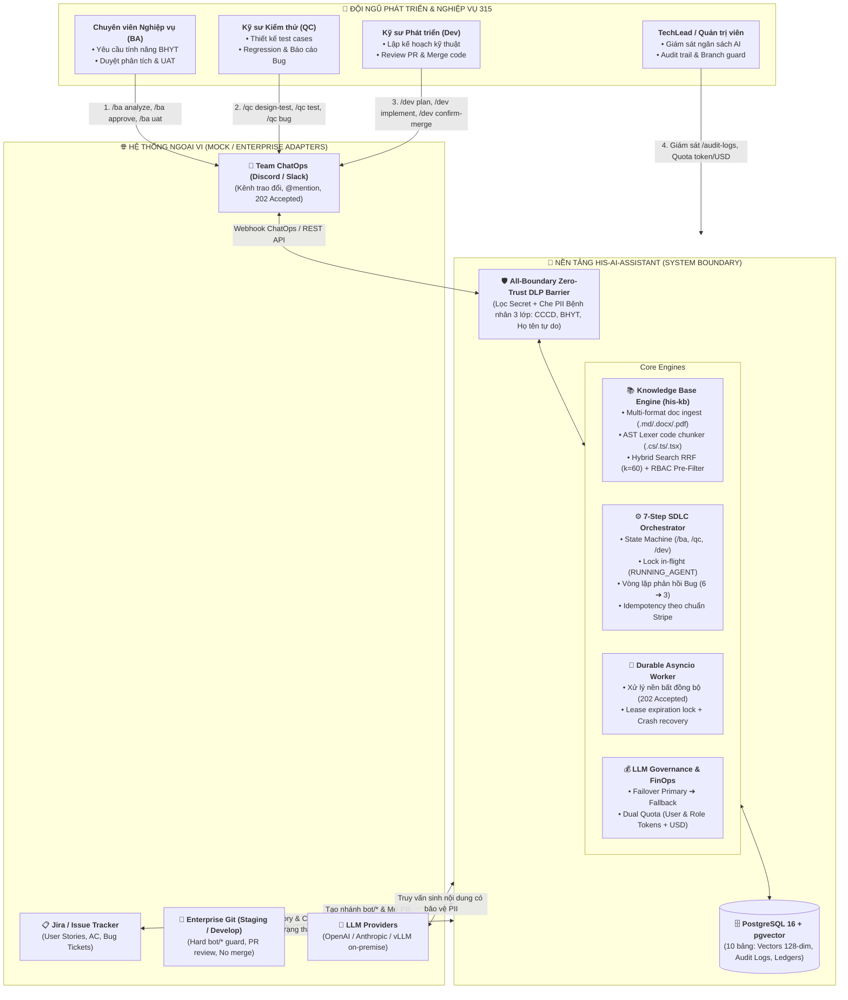

# HIS 315 AI Assistant & Knowledge Base (`his-ai-assistant`)

Hệ thống **Kho Kiến Thức HIS (`his-kb`)** và **AI Assistant điều phối quy trình phát triển 7 bước (BA – QC – Dev)** cho đội ngũ phát triển phần mềm bệnh viện/phòng khám 315.

---

## 1. Sơ Đồ Ngữ Cảnh Hệ Thống (System Context Diagram — C4 Level 1)

Sơ đồ ngữ cảnh định vị toàn diện hệ thống `his-ai-assistant` trong hệ sinh thái phát triển phần mềm y tế của 315:



---

## 2. Tính Năng Chính

- **Phần A — Tool nạp & tra cứu kiến thức HIS (`his-kb`)**:
  - **Chunking tài liệu nghiệp vụ (`.md`, `.docx`, `.pdf`)**: Tách theo tiêu đề mục (Heading) và giữ nguyên vẹn cấu trúc bảng biểu, kèm metadata (`file`, `heading`, `page`, `his_module`).
  - **Chunking source code nhánh `staging` (`.cs`, `.ts`, `.tsx`)**: Sử dụng **State-Machine Lexer đếm ngoặc `{}`** (bỏ qua `{}` trong chuỗi ký tự, interpolated/verbatim string, template literal và comment) để tách theo `class/method` hoặc `component/function` mà không bao giờ cắt ngang thân hàm; tự động bỏ qua `bin/`, `obj/`, `node_modules/` và trích xuất **Code Map** (`route`, `http_method`, `controller`, `entity`).
  - **All-Boundary DLP (Data Loss Prevention)**: Chặn Secret (connection string, API key, JWT, private key) và che PII bệnh nhân 3 lớp (họ tên có nhãn ngữ cảnh, họ tên tiếng Việt tự do 2–4 âm tiết, gazetteer; CCCD; mã thẻ BHYT; SĐT; ngày sinh; email; mã hồ sơ bệnh án) trước khi ghi xuống DB, log (`SanitizingLogFilter`), LLM prompt và API output.
  - **Nạp tăng dần (Incremental Indexing)**: Đối chiếu `SHA-256 file_hash` để chỉ xử lý file thêm mới/sửa/xoá và lưu `commit SHA` thực tế của nhánh `staging`.
  - **Tra cứu kết hợp Vector + Từ khoá (`RRF k=60`) & Phân quyền RBAC trước Top-K**: Kết hợp `pgvector` (Vector 128 chiều) và Full-Text Search có tách từ `CamelCase`/tiếng Việt; lọc quyền **trước** khi xếp hạng (`BA` và `QC` chỉ nhận `doc` + `code_map`, tuyệt đối `0` `source_code`; `Dev` nhận đủ cả 3 loại), luôn đính kèm trích dẫn nguồn (`citation`).
  - **Đánh giá chất lượng (`his-kb eval`)**: Bộ 10 câu hỏi mẫu kèm đáp án chuẩn kiểm tra chỉ số `Recall@5` (đạt `1.00`, vượt ngưỡng mục tiêu `>= 0.80`).
- **Phần B — AI Assistant điều phối quy trình 7 bước (BA, QC, Dev)**:
  - **Xử lý lệnh chat bất đồng bộ & bền vững**: `POST /chat/commands` idempotent theo `messageId` (kèm kiểm tra `payload_sha256` trả `422` nếu sửa đổi payload của cùng `messageId`), trả ngay `202 Accepted + taskId`, thực thi nền qua `DurableAsyncioWorker` có cơ chế Lease (`lease_expires_at` + `SELECT FOR UPDATE SKIP LOCKED`) và tự động phục hồi job khi restart.
  - **State Machine 7 bước & Role Gate**: Cấm nhảy cóc bước (`409 Conflict`), khóa trạng thái in-flight (`RUNNING_AGENT`) chống duyệt sớm khi Agent đang chạy nền, kiểm tra đúng Role tại từng cửa duyệt (`403 Forbidden`), hỗ trợ vòng lặp Bước 6 `QC` báo `bug` quay về Bước 3 (`loop_count`).
  - **Bảo vệ nhánh Git cứng (`GitAdapter`)**: `_validate_bot_write_branch()` chỉ cho phép ghi vào nhánh `bot/<key>`, chặn tuyệt đối `main`, `develop`, `staging` và mọi biểu thức refspec/path traversal (`:`, `..`, `refs/`, `+`, `--force`), không có phương thức `merge()`, mở/cập nhật PR idempotent từ `bot/<key>` vào `develop`.
  - **LLM Router & Quản trị hạn mức tháng**: Tự động failover từ `PrimaryMockLLMProvider` sang `FallbackMockLLMProvider` khi lỗi; theo dõi và chặn khi vượt hạn mức tháng theo **cả Token và Chi phí USD (`cost_usd`)** cho từng `userId` và `role`.

---

## 3. Khởi Chạy Nhanh Bằng 1 Lệnh (`docker compose up`)

Hệ thống không yêu cầu bất kỳ API key bên ngoài nào (toàn bộ LLM, Jira, Git, Discord đều có bản cài đặt Mock/Local sau `Protocol` interface và chuyển đổi qua biến môi trường):

```bash
cp .env.example .env
docker compose up --build
```

Khi khởi chạy, container `app` tự động:
1. Khởi tạo kho Git mẫu nhánh `main`, `develop`, `staging` tại `./sample_data/his_staging` (idempotent).
2. Chạy migration `alembic upgrade head` tạo extension `vector` và 10 bảng trên PostgreSQL 16 (`pgvector/pgvector:pg16`).
3. Chạy `his-kb ingest` nạp toàn bộ tài liệu và code mẫu nhánh `staging`.
4. Khởi động FastAPI server + `DurableAsyncioWorker` tại `http://localhost:8000`.

---

## 4. Chạy Trực Tiếp Trên Máy Local & Sử Dụng CLI `his-kb`

```bash
# 1. Cài đặt dependencies vào virtualenv
pip install -e ".[dev]"

# 2. Khởi tạo dữ liệu mẫu nhánh staging và chạy migration
python -m sample_data.init_sample_repo
alembic upgrade head

# 3. Nạp kiến thức tăng dần từ nhánh staging
python -m app.cli ingest --repo-path ./sample_data/his_staging --branch staging

# 4. Xem trạng thái kho kiến thức (commit SHA nhánh staging, số chunk, thống kê DLP)
python -m app.cli status

# 5. Tra cứu theo Role (BA/QC chỉ thấy doc + code_map; Dev thấy thêm source_code)
python -m app.cli search "kiểm tra thông tuyến thẻ BHYT 5 năm liên tục" --role BA
python -m app.cli search "RegisterOutpatientBhytAsync FiveYearContinuousDate" --role Dev

# 6. Chạy đánh giá Recall@5 trên bộ 10 câu hỏi chuẩn
python -m app.cli eval --dataset ./sample_data/eval_questions.json --k 5
```

---

## 5. Ví Dụ Gọi REST API & Chạy Kịch Bản 7 Bước (`story_workflow.http`)

- Mở file [`story_workflow.http`](./story_workflow.http) trong VS Code (REST Client) hoặc JetBrains HTTP Client để bấm chạy tuần tự 21 bước từ Bước 1 đến Bước 7 (bao gồm cả test chặn sai Role `403`, vòng lặp báo lỗi `6 -> 3 -> 4 -> 5 -> 6` và nghiệm thu đóng Story `DONE`).
- Ví dụ gọi bằng `curl`:

```bash
# Tra cứu kiến thức qua POST /search
curl -X POST http://localhost:8000/search \
  -H "Content-Type: application/json" \
  -d '{"userId":"ba_user","role":"BA","query":"điều kiện 5 năm liên tục BHYT","topK":5}'

# Gửi lệnh Bước 1: BA yêu cầu phân tích Story HIS-101 (trả về 202 Accepted + taskId)
curl -X POST http://localhost:8000/chat/commands \
  -H "Content-Type: application/json" \
  -d '{"messageId":"msg-001","userId":"ba_user","channel":"his-315","text":"/ba analyze HIS-101"}'

# Kiểm tra trạng thái Story và Audit Logs
curl http://localhost:8000/stories/HIS-101
curl "http://localhost:8000/audit-logs?story_key=HIS-101"
```

---

## 6. Chạy Kiểm Thử Tự Động (`pytest`) & Kiểm Tra Code (`ruff`)

```bash
ruff check .
pytest -v
```

---

## 7. Ghi Chú Về Công Cụ AI Đã Sử Dụng

- **Công cụ AI hỗ trợ**: Sử dụng AI Coding Assistant (Claude / Gemini trong quy trình AI-DLC) để hỗ trợ:
  1. Phác thảo khung kiến trúc tách lớp (Ports & Adapters), sơ đồ tuần tự và schema 10 bảng SQLAlchemy 2.0 + Alembic.
  2. Sinh dữ liệu mẫu nghiệp vụ HIS 315 (tiếp nhận ngoại trú BHYT, kê đơn dược, thanh toán viện phí) và bộ 10 câu hỏi đánh giá `eval_questions.json`.
  3. Viết các bài kiểm thử tự động (`pytest`) phủ các ca biên và tấn công bảo mật.
- **Phần do kỹ sư trực tiếp thiết kế, kiểm soát và hiệu chỉnh**:
  - Thiết kế **State-Machine Lexer** đếm ngoặc `{}` trong `app/kb/code_chunker.py` để khắc phục lỗi regex cắt nhầm thân hàm khi gặp dấu `{}` bên trong C# interpolated string `$"..."`, verbatim string `@"..."`, comment hoặc JSX.
  - Thiết kế cơ chế **RBAC Pre-Filtering trước khi cắt Top-K** trong `app/kb/search_service.py` để đảm bảo `BA`/`QC` không bao giờ bị lộ `source_code` hoặc bị hụt kết quả.
  - Thiết kế hàm bảo vệ nhánh `_validate_bot_write_branch()` trong `app/adapters/git_adapter.py` chống lại 10 vector tấn công refspec/path traversal và Prompt Injection từ nội dung ticket Jira.
  - Thiết kế khóa trạng thái in-flight `RUNNING_AGENT` và cơ chế Lease/Reclaim trong `app/workflow/worker.py`.
